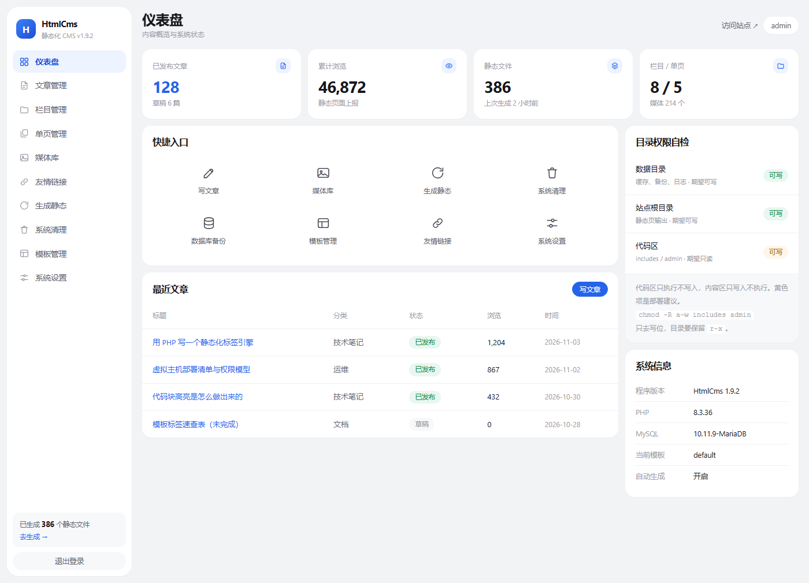

# CiciCMS

[](https://www.php.net/)
[](https://www.mysql.com/)
[](LICENSE)
[](https://github.com/hexoblog-web-site/CiciCMS/releases)

PHP + MySQL 的**静态化内容管理系统**。后台按国内站长熟悉的习惯组织：文章列表、栏目树、单页、模板、一键生成，不需要重新学一套操作逻辑；程序健壮性按长期运营的实战要求设计：全部 SQL 预处理、CSRF 校验、原子写盘、登录限速、内容过滤、备份与旧文件清理。

发布内容后一键生成纯静态 HTML（首页、分类、文章、单页、标签、归档、友链、404、sitemap、RSS），可直接跑在普通虚拟主机上，无需伪静态、无需 Composer、无需命令行。

正文支持代码块围栏（```php），保存时自动转成深色代码面板，适合写技术教程；编辑器保持纯 textarea，不引入富文本，不做任何字符替换。



---

## 一、环境要求

| 项目 | 要求 |
| --- | --- |
| PHP | 7.0 及以上（推荐 7.4 / 8.0+） |
| 扩展 | PDO、PDO_MySQL、JSON（必需）；Mbstring、GD（推荐） |
| MySQL | 5.6 及以上（MariaDB 10.x 亦可） |
| Web 服务器 | Apache（含 .htaccess）或 Nginx，虚拟主机即可 |
| 目录权限 | 站点根目录与 `content/` 可写（755）；`includes/`、`admin/` 建议只读 |

不需要 Composer、Node、Redis、伪静态规则、定时任务。

---

## 二、安装

1. 把全部文件上传到站点根目录（或子目录）。
2. 浏览器访问 `http://你的域名/install/`。
3. 第一步：环境检测；第二步：填写数据库、站点、管理员信息；提交后自动建表、写入 `config.php`、生成首页静态文件。
4. 安装完成后**删除 `install` 目录**，进入 `/admin/` 登录。

重新安装：删除 `config.php` 与 `content/data/install.lock`，清空原数据表后再访问安装目录。

---

## 三、目录结构

程序把文件分成三个区。划分依据有两条：**升级时谁该被覆盖**，以及**运行期谁能写、谁能执行**。

| 分区 | 目录 | 运行期可写 | 运行期可执行 | 部署权限 | 升级时 |
| --- | --- | --- | --- | --- | --- |
| 系统区 | `includes/` `admin/` `install/` | 否 | 是（PHP） | 只读（555；或 755 且属主为 root） | 整体覆盖 |
| 内容区 | `content/` | 是 | 否（两处例外，见 3.3） | 必须可写（755） | **保留，绝不覆盖** |
| 入口 | 根目录的 `.php` 与 `config.php` | 仅 `config.php` 由安装程序写一次 | 是 | `config.php` 装完只读 | 保留 |

一句话记法：**代码区只执行不写入，数据区只写入不执行。**

所以升级只有一句话：**覆盖 `includes/`、`admin/`、`install/`，`content/` 和 `config.php` 不要动。**

```
/
├── index.php                前台入口（动态预览 / 搜索 / 404）
├── api.php                  浏览量计数接口
├── config.php               安装时生成，数据库配置
├── .htaccess                静态首页优先 + 敏感文件保护
│
├── includes/                【系统区】升级整体覆盖
│   ├── bootstrap.php        统一引导：常量、配置、会话、错误处理
│   ├── db.php               PDO 封装（q/all/one/val/insert_row/update_row）
│   ├── functions.php        公共函数：URL、模板、上传、CSRF、文件、分页
│   ├── content.php          正文渲染：代码块围栏转 HTML、摘要提取
│   ├── auth.php             登录、会话、失败限速
│   ├── frontend.php         前台数据查询与页面渲染
│   ├── builder.php          静态生成器（含 manifest 清理）
│   ├── backup.php           数据库备份：生成 SQL、列出备份、校验下载路径
│   ├── upload.php           图片上传：大小/后缀/MIME 校验、随机命名、入库登记
│   ├── clean.php            系统清理：扫描未被引用的附件，删除文件与记录
│   ├── tags.php             标签引擎入口（只放说明与加载顺序）
│   ├── tags/                标签引擎：一个标签一个文件
│   │   ├── registry.php     注册表，扫描下面三个目录
│   │   ├── engine.php       扫描器、编译缓存、按名字分发
│   │   ├── context.php      编译期工具（属性 / 修饰器 / 路径）
│   │   ├── single/          单标签：url theme year include pager field …
│   │   ├── block/           块标签：list if nav tags archive flink each …
│   │   ├── fields/          字段级覆盖，如 fields/title.php
│   │   └── runtime/         运行时函数，编译产物直接调用
│   ├── upgrade.php          数据库结构自动升级
│   └── config.sample.php    配置样例
│
├── admin/                   【后台】升级整体覆盖
│   ├── index.php            后台单入口路由
│   ├── login.php            登录页
│   ├── download.php         数据库备份下载
│   ├── inc/                 后台头尾布局
│   ├── assets/              后台 CSS/JS
│   └── pages/               dashboard/article/category/page/media/flink/build/theme/setting
│
├── install/                 安装向导（装完必须删除整个目录）
│
├── content/                 【内容区】升级保留，可写但不执行
│   ├── themes/              主题：一套纯 HTML 模板 + 样式
│   │   └── default/         默认主题（.html + {cici:} 标签，不含 PHP）
│   ├── uploads/             上传图片，按年/月分目录，禁止执行脚本
│   ├── plugins/             插件，一个插件一个目录，升级不覆盖
│   │   ├── .htaccess        禁止直接访问 .php/.json，只放行资源文件
│   │   ├── highlight/       代码高亮（默认启用）
│   │   └── hexo-import/     Hexo Markdown 批量导入
│   └── data/                运行数据，禁止外部访问
│       ├── cache/tpl/       标签模板编译缓存（会被 include，属例外）
│       ├── logs/            错误日志
│       └── backup/          SQL 备份、模板修改备份
│
└── <分类目录>/             静态生成后自动创建，如 minjiangushi/5.html、minjiangushi/index.html
                             另有 page/（首页分页）、tag/、tags.html、archive.html、links.html、404.html
                             根目录可写，但只写 .html/.xml（build_allowed_ext 强制）
```

### 3.1 新增文件该放哪

按顺序问四个问题：

1. 是**程序代码**还是**用户数据**？→ 代码进 `includes/`，数据进 `content/`
2. 是**后台界面**吗？→ 是的话进 `admin/pages/`
3. **运行期需要写它吗**？→ 需要写的，绝不能放 `includes/`、`admin/`（这两处运行期一个字节都不写）
4. **升级时该保留吗**？→ 该保留的，绝不能放 `includes/`

### 3.2 权限模型：只执行不写 / 只写不执行

这两条不是口号，是可以在服务器上落实的：

| 区域 | 目录 | 规则 | 落实手段 |
| --- | --- | --- | --- |
| 只执行不写 | `includes/` `admin/` `install/` | 运行期不产生任何新文件 | 目录设只读（`chmod -R a-w`），升级时临时改回可写再覆盖 |
| 只写不执行 | `content/uploads/` `content/data/` 根目录静态页 | 能写，但写进去的脚本跑不起来 | `.htaccess` 拒绝脚本后缀；Nginx 加 `location ~ ^/content/.*\.(php\|phtml)$ { deny all; }` |

> **`includes/` 必须保留 `r-x`（555），不能设成 `--x`。** `includes/tags/registry.php` 用 `glob()` 扫描 `tags/single`、`tags/block`、`tags/fields`，`includes/tags.php` 扫描 `tags/runtime`；目录一旦去掉 `r`（列目录），`glob()` 返回空数组，标签注册表为空，所有 `{cici:}` 标签集体失效，前台直接白屏。只去掉写位（`chmod a-w`）就对了，读和执行位都要留着。
>
> 后台「仪表盘 → 目录权限自检」会同时看这两件事：`includes/`、`admin/` 可写会标黄；不可列目录也会标黄，并提示"不可列目录"。

**为什么值得这么做**：后台一旦被攻破，攻击者最先想干的是往能被访问到的地方丢一个 `shell.php`。上传目录禁执行、代码区只读，这两步就把最常见的一条路堵死了——他既写不进代码区，写进上传目录也执行不了。

后端代码里对应的三道保险：

- `build_put()` 只允许写 `.html .htm .xml .txt .json`（`build_allowed_ext()`），静态生成不可能产出可执行文件，即使站点根目录必须可写。
- `build_put()` 还会拒绝任何落在 `admin/` `includes/` `install/` `content/` `docs/` 的路径（`cms_is_system_rel()`）。这是代码层的护栏：就算栏目别名被直接改库改成 `admin`，生成器也只会报「拒绝写入系统目录」，不会往代码区丢文件；清理旧静态文件时同样跳过这些目录。
- 上传走 `media.php`：扩展名白名单 + `getimagesize()` 真实图片校验 + 随机文件名，不信任浏览器给的 MIME。

**关于 `chmod` 的实话**：`chmod -R a-w` 挡得住"别的程序、别的账号"往里写，挡不住已经拿到 PHP 执行权的人——Linux 下文件属主可以自己把写权限 `chmod` 回来。要做到真正不可写，得让 `admin/` 的属主不是 PHP 运行用户（例如 root 拥有、PHP 用户只在组内只读），或者用 `chattr +i`、只读挂载。虚拟主机（FTP 账号就是 PHP 用户）通常做不到这一点，那就别只指望权限：定期用发布包的哈希比对 `admin/`、`includes/` 更实在，发现被改就整目录覆盖回去。

**只读之后哪些功能照常**：发文章、改栏目、传图、编辑主题、切模板、数据库备份、静态生成、登录，全部不写 `admin/`，只写数据库、`content/` 和站点根。唯一要做的是**升级**：先 `chmod -R u+w includes admin`，覆盖完再改回只读。

### 3.3 一处例外（必须知道）

`content/` 里唯一会被执行的东西，是标签编译缓存：

| 位置 | 为什么可执行 | 怎么控 |
| --- | --- | --- |
| `content/data/cache/tpl/*.php` | `{cici:}` 标签模板的编译产物，`include` 执行 | 只能由主题源码编译生成，不接收外部内容；`content/data/.htaccess` 整层 `Require all denied` |

内置主题已全部改为纯 HTML 标签模板，所以 `content/themes/` 下**没有 PHP 文件**，"可写区不执行"成立。

如果自己写 PHP 主题（见第七节，属高级用法），那 `content/themes/*/index.php` 就是代码，会把这条打破：只有后台"模板管理"能改（需登录 + CSRF + 文件名白名单 + 目录越界校验），`content/themes/.htaccess` 也会拒绝直接请求 `.php`。**主题编辑权限等同于改代码权限**，只给管理员。

### 3.4 部署检查清单

Linux / Apache：

```bash
# 代码区只读：只去写位，目录保留 r-x（切勿 chmod 111 或 --x）
chmod -R a-w includes admin
chmod -R u+w content                 # 内容区可写
chmod 444 config.php                 # 配置只读
rm -rf install                       # 装完删掉安装目录
```

后台"仪表盘 → 目录权限自检"会按上表逐项核对，黄色项就是还没落实的。

### 3.5 从 1.3 升级到 1.4

1.3 及以前 `templates/`、`uploads/`、`data/` 直接放在站点根目录。1.4 起统一收进 `content/` 下。

直接覆盖程序文件即可，首次访问时程序会自动把这三个老目录搬进 `content/`，`content/` 里已有真实数据时不会覆盖。搬完请确认根目录不再有 `data/`、`templates/`、`uploads/` 三个目录。

### 3.6 从 1.4 升级到 1.5（URL 结构变了）

| 老地址 | 新地址 |
| --- | --- |
| `/post/hello-world.html` | `/minjiangushi/5.html` |
| `/cat/minjiangushi/index.html` | `/minjiangushi/index.html` |

升级步骤：

1. 覆盖 `includes/`、`admin/` 两个目录（`content/` 不动）。
2. 后台"生成静态"点一次**全量重建**，新的目录结构才会落地。
3. 重建结束后，`post/`、`cat/` 两个老目录会被清单清理自动删除（里面已无有用文件）。
4. 老链接不必手工处理：服务器把"文件不存在"的请求交给 `index.php`，由它 301 到新地址（规则见下节）。

注意两点：

- 文章地址改用 ID，**slug 不再出现在 URL 里**，改标题不会让地址失效。
- 分类的"目录名"现在直接是网址目录，所以不能再叫 `page`、`tag`、`post`、`cat`、`admin` 等（后台保存时会拦下）。

### 3.7 从 1.5 升级到 1.6（栏目设置）

1. 覆盖 `includes/`、`admin/`、`install/` 三个目录，`content/` 与 `config.php` 不动。
2. 首次访问任意页面时，`category` 表会自动补上 `banner` 字段（日志记 `schema: category.banner added`），不需要手工执行 SQL。
3. 后台"栏目管理"改成了一个栏目一页设置：标题、别名、URL、关键词、描述、横幅。
4. 横幅只在模板调用时输出，**旧主题不显示横幅属于正常**——内置主题已支持（`{cici:if $cat.banner_url}` 那一段）。

### 3.8 从 1.7 升级到 1.8（默认主题改为纯 HTML）

1. 覆盖 `includes/`、`admin/`、`install/` 三个目录，`content/` 与 `config.php` 不动。
2. **内置主题不再有 PHP**：`default` 全部换成 `{cici:}` 标签的 `.html`，原 `cici` 主题已合并进来（内容一致，`cici` 目录不再发布）。
3. 因为 `content/` 升级时保留，你站上的 `content/themes/default` **不会被自动替换**。想用新主题，先把它改名备份，再从安装包复制 `content/themes/default` 过去：

   ```bash
   mv content/themes/default content/themes/default-old
   cp -r <安装包>/content/themes/default content/themes/
   ```

   不想换也能照常跑，旧的 PHP 主题继续有效。
4. 如果你之前启用的是 `cici` 主题，而站上已没有这个目录，程序会自动回落到 `default`，不会白屏。
5. 换完进后台"模板管理"点一次"全量生成"。

### 3.9 从 1.8 升级到 1.9（安全修复）

1. 覆盖 `includes/`、`admin/`、`install/`，`content/` 与 `config.php` 不动。
2. 数据库自动补 `page.content_src`（单页也支持代码块围栏，且二次编辑拿得到原文），访问任意页面即触发，日志会写 `schema: page.content_src added`。
3. 本次修复不需要手工改数据，但**建议改完后重置一次后台密码**（历史上正文净化存在 HTML5 命名实体绕过，若站点曾接收过外部投稿请视为已污染）。
4. 部署在 Nginx 上时，按第二章的参考配置补上 `content/data`、`content/uploads` 脚本拒绝、`docs/` 三条 `deny`。
5. 在 CDN 后面才勾选「采信 X-Forwarded-For」，直连站点不要勾。

### 3.10 从 1.9.0 升级到 1.9.1（目录只读加固）

这次是加固，没有数据库变更，覆盖 `includes/`、`admin/`、`install/` 即可：

1. 新增 `cms_system_dirs()` / `cms_is_system_rel()`：静态生成和清理旧文件时，一律拒绝 `admin/`、`includes/`、`install/`、`content/`、`docs/` 下的路径。以前只有栏目页生成校验了保留目录，文章路径是直接用栏目的 `dirname` 拼的，脏数据（直接把库里栏目别名改成 `admin`）能把文章写进后台目录；现在两条路都堵上了。
2. 因此 `admin/`、`includes/`、`install/` 可以放心设成只读，后台所有功能照常（详见 3.2、3.3）。
3. 版本号变化会让标签编译缓存整体失效一次，首次访问自动重建，不用手工清 `content/data/cache/tpl`。
4. 升级后如果生成日志里出现「拒绝写入系统目录」，说明某个栏目别名和程序目录重名了，把别名改掉再生成一次即可，数据本身不会丢。

### 3.11 从 1.9.1 升级到 1.9.2（后台界面改版）

纯前端改动，没有数据库变更，只覆盖 `admin/assets/admin.css`、`admin/inc/header.php`、`admin/inc/footer.php`、`admin/pages/dashboard.php` 等模板文件即可。

1. 视觉语法对齐移动端应用商店：`#F2F3F5` 浅灰底 + 纯白卡片、去掉卡片 1px 边框、圆角 16px、卡片间距 12px；侧栏改浮岛白卡。
2. 侧栏图标从 Unicode 字符（`◫ ▤ ▦`）换成 24px 线性 SVG，由 `currentColor` 跟随选中态。
3. 按钮统一胶囊（主按钮实心蓝、次按钮描边），字号收口为 24 / 15.5 / 13.5 / 12 / 11 五级。
4. 仪表盘新增「快捷入口」2×4 网格；权限自检表由三列简化为「项目 + 状态」两列。
5. `select` 加自定义下拉箭头（`appearance:none` + 内联 SVG），跨浏览器高度一致。
6. 静态文件仍沿用原路径，旧 CSS 缓存请强刷一次（Ctrl+F5）。

### 3.12 从 1.9.2 升级到 1.9.3（第三方许可合规）

没有数据库变更，覆盖 `content/themes/default/assets/prism.bundle.js`、`content/themes/default/footer.html`、`THIRD-PARTY-NOTICES.md` 三个文件即可。

1. `prism.bundle.js` 顶部补回 PrismJS 的 MIT 版权与许可声明（原压缩产物中缺失，不符合 MIT 的保留声明要求）。
2. 新增 `THIRD-PARTY-NOTICES.md`，列明随程序分发的第三方组件、许可证全文，以及未打包字体/图标/图片的说明。
3. 默认主题页脚「Powered by」链接由占位域名改为项目仓库地址。
4. 已生成的静态页需重新生成一次，页脚链接才会更新。

### 3.13 从 1.9.3 升级到 1.9.4（移除代码高亮）

没有数据库变更。

1. 删除 `content/themes/default/assets/prism.bundle.js` 与 `assets/code.css`。
2. 从 `header.html` 移除 `code.css` 引用，从 `footer.html` 移除 `prism.bundle.js` 脚本。
3. 代码块改为纯文本呈现，外观由 `style.css` 的 `.entry-content pre` 提供（深色面板、等宽字体、横向滚动）。
4. `class="language-xx"` 仍保留在 `<pre><code>` 上，将来接入任何高亮库时内容无需改动。
5. 已生成的静态页需重新生成一次，页面里不再有那两个资源标签。
6. 自 1.9.4 起，程序不含任何第三方运行时代码。

### 3.14 从 1.9.4 升级到 1.9.5（正式定名 CiciCMS）

没有数据库变更，没有表结构变化。

1. 程序名统一为 **CiciCMS**：版本常量、安装向导、后台标题与侧栏、登录页、页脚、README、LICENSE、文档站包名全部改名。
2. 删除源码与文档中所有对其它 CMS 品牌的引用，兼容功能照旧保留（字段别名、`limit="0,10"`、`orderby` 写法仍可用），只是不再提来源。
3. 会话名 `HTMLCMSSID` → `CICICMSSID`，登录态会失效一次，重新登录即可。
4. 标签页 slug 的哈希盐值随改名变化，**所有标签页 URL 会变**；升级后请重新生成一次静态页，并让生成器清理旧文件（后台「系统清理 → 清理无主静态文件」）。
5. 数据库备份文件名前缀改为 `cicicms-`；数据库名、表名、字段名**未改动**，老库可直连。
6. 部署目录名可继续沿用旧名，不影响运行；想统一的话，整目录改名后仅需确认 `config.php` 中的站点路径设置。

### 3.15 从 1.9.5 升级到 2.0.0（插件系统）

没有数据库表结构变更，新增一个配置项与一个目录。

1. 新增 `content/plugins/` 插件目录，内含 `highlight`（代码高亮）与 `hexo-import`（Hexo 导入）两个插件。
2. 新增插件内核 `includes/plugin.php`：过滤器 / 动作两类钩子，13 个钩子点，见第八节。
3. 后台新增「插件管理」页，可启用、停用、进入插件自带页面。
4. 新装站点默认启用代码高亮；老站点第一次进「插件管理」手动启用即可。
5. 系统设置 → 数据库备份新增**恢复**：可从已有备份或上传 `.sql` 恢复，需输入 `RESTORE` 确认，执行前自动再备份一次。
6. 恢复只执行备份文件本身会产生的语句（`SET` / `INSERT` / `TRUNCATE`），其余一律拒绝；全程在事务内，出错整体回滚。
7. 启用插件后请重新生成一次静态页，插件注入的资源才会出现在已生成的 HTML 里。

---

## 四、URL 规则

| 内容 | 静态地址 | 动态预览 |
| --- | --- | --- |
| 首页 | `/index.html`、`/page/2/index.html` | `/index.php?page=2` |
| 文章 | `/minjiangushi/5.html`（分类目录 + 文章 ID） | `/index.php?p=hello-world` |
| 分类 | `/minjiangushi/index.html`、`/minjiangushi/page/2/index.html` | `/index.php?cat=minjiangushi` |
| 单页 | `/about.html` | `/index.php?single=about` |
| 标签 | `/tag/1a2b3c4d5e.html` | `/index.php?tag=标签名` |
| 搜索 | 动态（`index.php?s=关键词`） | 同左 |
| 归档 | `/archive.html` | 动态预览无对应页 |
| 友链 | `/links.html` | 动态预览无对应页 |
| 其他 | `/sitemap.xml`、`/rss.xml`、`/tags.html`、`/404.html` | — |

**文章地址用 ID 不用 slug**：`/minjiangushi/5.html` 里的 5 是文章 ID。改标题、改英文路径都不会让地址失效；只有把文章移到别的分类，目录名才会变（旧地址自动 301 过去）。

**分类目录直接落在站点根**，所以分类的"目录名"就是网址里的目录，不能和系统目录重名（`page`、`tag`、`post`、`cat`、`admin`、`includes`、`install`、`content` 等），后台保存时会直接拦下。

静态文件直接落在站点根目录，Apache 由 `DirectoryIndex index.html index.php` 优先命中静态首页。**静态页已存在的请求不经过 PHP**，只有"文件不存在"的请求才交给入口：老地址 → 301，真没有 → 404 页面。

Nginx 参考：

```nginx
index index.html index.php;
location / {
    try_files $uri $uri/ /index.php?$query_string;
}
location ~ \.php$ {
    fastcgi_pass unix:/run/php/php-fpm.sock;
    fastcgi_param SCRIPT_FILENAME $document_root$fastcgi_script_name;
    include fastcgi_params;
}
location ~ ^/(content/data|includes|install)/ { deny all; }
# 附件目录只放静态文件，绝不允许执行脚本
location ~* ^/content/uploads/.*\.(php|phtml|phar|pht)$ { deny all; }
# 文档源码目录（VitePress + node_modules），不属于站点内容
location ~ ^/docs/ { deny all; }
```

> `docs/` 只在开发机上存在。真要在服务器上保留，上面的 `deny` 必须加；更彻底的做法是把它移出站点根目录。

从 1.4 起的地址变更（老链接自动 301，无需手工处理）：

| 老地址 | 新地址 |
| --- | --- |
| `/post/hello-world.html` | `/minjiangushi/5.html` |
| `/cat/minjiangushi/index.html` | `/minjiangushi/index.html` |
| `/cat/minjiangushi/page/2/index.html` | `/minjiangushi/page/2/index.html` |
| `/旧目录名/5.html`（分类改过名） | `/新目录名/5.html` |

---

## 五、后台功能

- **仪表盘**：文章/浏览/静态文件统计、2×4 快捷入口（写文章、媒体库、生成、清理、备份、模板、友链、设置）、目录权限自检、系统信息、生成状态。
- **文章管理**：筛选、置顶、草稿、标签、摘要、封面、自定义英文路径、**推荐位**（推荐/头条/图片/幻灯/特荐/滚动/加粗/图文），保存即自动重建静态页。
- **栏目管理**：一个设置页管六项——栏目标题、别名、URL、关键词、描述、栏目横幅（Banner）。别名即网址目录，改动会自动 301 老地址；横幅支持上传或填外链，作为栏目页页头背景；栏目下有文章时禁止删除（防误删数据）。
- **单页管理**：关于我们、联系方式等，输出 `/<slug>.html`。
- **媒体库**：图片上传（真实 MIME 校验、随机文件名）、地址一键复制、删除。
- **友情链接**：名称、网址、Logo、说明、排序、显隐、新窗口，输出到 `/links.html`。
- **生成静态**：全量生成、文件清单、耗时、清空静态文件。
- **系统清理**：扫描 `content/uploads/`，列出没有被任何内容引用的图片与附件（含"有记录但文件丢失"的失效记录），勾选后确认删除。判定口径见下文。
- **模板管理**：多模板切换、在线编辑模板文件（保存前自动备份）。
- **系统设置**：站点信息、每页条数、时区、页脚 HTML、自动生成开关、改密码、数据库 SQL 备份与下载。

### 系统清理怎么判断"没被引用"

扫描范围是 `content/uploads/` 下的每一个文件，逐个检查文件名是否出现在：

文章正文、文章编辑源文、摘要、封面，单页正文，栏目横幅，友情链接 Logo，系统设置的每一个配置值，以及当前主题的模板文件。

只要在上述任何一处出现过，就算"正在使用"，不会出现在待清理列表里。这是**故意保守**的口径：宁可少清理几个，也不能误删正在用的图。本系统上传的文件名带时间戳和随机串，撞名概率可以忽略。

删除时还有两道保险：

1. 提交后重新建立一次引用索引再核对（页面可能开了很久，期间刚插入的图会被跳过）；
2. 只删 `content/uploads/` 内的文件，绝对路径与 `..` 一律拒绝；主题图片（`content/themes/`）不参与扫描。

另外会列出"失效记录"——媒体库里登记了、但文件已经不在了。这类条目删除时只清记录，不动磁盘。

---

## 六、健壮性与安全设计

1. **SQL 注入**：所有查询走 PDO 预处理，`ATTR_EMULATE_PREPARES=false`；表名走白名单；LIMIT 强制整型。
2. **XSS**：输出统一 `e()` 转义；正文保存时移除 `<script>`、`<iframe>`、`on*` 事件与危险协议。链接类属性（`href`/`src`/`action` 等）逐个按浏览器规则归一化后再判断——先解 HTML5 命名实体（`&Tab;` `&NewLine;` `&colon;`），再去掉控制字符与空白，`java&Tab;script:` 这类拆分写法同样拦下。
3. **CSRF**：后台所有 POST 校验一次性会话 token；退出登录也要求 POST。
4. **暴力破解**：同 IP 15 分钟内失败 8 次即锁定；密码 `password_hash` 存储。站点在 CDN / 反代后面时，到「系统设置」勾选「采信 X-Forwarded-For」，否则全站访客会共用一个代理 IP 被一起锁住。
5. **上传**：扩展名白名单 + `getimagesize` 真实图片校验 + 随机文件名 + 独立目录禁止执行 PHP。
6. **文件写入**：先写临时文件再 `rename` 原子替换；路径拒绝 `..`；生成清单只删除自己写过的文件；渲染结果为空一律视为失败，不会写出空白页。
7. **并发生成**：`flock` 独占锁，状态在放锁前落盘；单个任务出错只记错误并跳过，不会让整轮生成卡死。
8. **错误处理**：异常统一捕获写 `content/data/logs`，生产环境不暴露堆栈；`config.php`、日志、SQL 备份由 htaccess 拒绝访问。
9. **删除保护**：分类下有文章不允许删除；删除文章/单页会同步清理旧静态文件。
10. **备份**：后台一键导出全库 SQL，可直接用 phpMyAdmin 恢复。
11. **会话**：只在实际需要时启动（后台、登录、CSRF、flash）。前台静态请求不建 session 文件，虚拟主机不会因为访客多而堆积几十万个空会话。
12. **受信入口**：`site_footer` 按设计原样输出 HTML，等同于一个"管理员可写任意 HTML"的入口——后台账号本身即最高权限，不要把它交给不可信的人。

---

## 七、模板开发

主题放在 `content/themes/<主题名>/`。**内置主题是纯 HTML**，改版只需要会 HTML：把 `{cici:xxx}` 当成"会自己变内容的占位符"，改字、改结构都行，不用写一行 PHP。

| 写法 | 文件 | 说明 |
| --- | --- | --- |
| 标签模板（**默认，推荐**） | `xxx.html` | 纯 HTML + `{cici:}` 标签，后台"模板管理"可直接改，保存即生效 |
| PHP 模板（高级，可选） | `xxx.php` | 只有需要复杂逻辑（自定义查询、第三方 SDK）时才用；写错会导致整站白屏 |

同名文件同时存在时 `.html` 优先。主题里只要有 `index.html`（或 `index.php`），后台"模板管理"就能切换，列表里会标出类型。

### 7.1 做一个自己的主题（复制即用）

1. 复制 `content/themes/default/` 整个目录，改名为比如 `mytheme/`；
2. 进后台"模板管理"，列表里就会多出 `mytheme`，点"启用"；
3. 直接改里面的 `.html`：文字、图片、排版随你，`{cici:}` 开头的标签**保留原样**别删；
4. 改坏了？`content/data/backup/theme/` 里有每次保存前的自动备份，拷回来即可。

一个主题必须齐全的文件（缺一个该页面就会 500）：`header.html` `footer.html` `index.html` `list.html` `loop.html` `article.html` `page.html` `tags.html` `archive.html` `search.html` `links.html` `404.html`，外加 `style.css`。`assets/` 可选，用于主题自带的图片、字体或脚本（默认主题当前不使用）。

### 7.2 九种页面与模板对应关系

| 页面 | 模板 | 输出地址 | 主要标签 |
| --- | --- | --- | --- |
| 首页 | `index.html` | `/index.html`、`/page/2/index.html` | `list` `channelartlist` `pager` |
| 列表页（分类） | `list.html` | `/minjiangushi/index.html` | `position` `list`/`posts` `pager` |
| 内容页 | `article.html` | `/minjiangushi/5.html` | `position` `post.*` `prev` `next` `related` `tags` |
| 标签云 | `tags.html` | `/tags.html` | `tags` |
| 标签详情 | `list.html` | `/tag/xxx.html` | `list`（或 `posts` 变量）`pager` |
| 归档页 | `archive.html` | `/archive.html` | `archive` |
| 搜索页 | `search.html` | `/index.php?s=关键词`（动态） | `posts` `pager` `kw` |
| 单页 / 关于 | `page.html` | `/about.html` | `position` `post.title` `post.content` |
| 友链页 | `links.html` | `/links.html` | `flink` |

### 7.3 变量与字段

| 写法 | 说明 |
| --- | --- |
| `{cici:site.name}` | 站点：`name` `desc` `keywords` `url` `icp` `footer` `per_page` |
| `{cici:title}` `{cici:desc}` `{cici:keywords}` `{cici:canonical}` `{cici:body_class}` `{cici:kw}` | 页面级变量 |
| `{cici:post.xxx}` | 文档字段，见下表 |
| `{cici:cat.xxx}` | 分类：`name` `dirname` `description` `keywords` `banner` `banner_url` `url` `count` |
| `{cici:item.xxx}` | 循环内当前项（列表里 `post.xxx` 也会回退到当前项） |
| `{cici:url}` `{cici:theme}` `{cici:year}` | 站点根地址 / 主题目录 / 当前年份 |

文档字段除表里真实的 `title` `slug` `excerpt` `content` `cover` `tags` `views` `created_at` 外，还会自动补虚拟字段：

`url` `date` `datetime` `year` `month` `day` `summary` `cat_name` `cat_url` `tag_list` `flag_list` `index`

**兼容字段别名**，旧模板里的常见写法可直接沿用：

| 别名 | 本站字段 | 别名 | 本站字段 |
| --- | --- | --- | --- |
| `arcurl` | `url` | `litpic` | `cover` |
| `pubdate` | `created_at` | `click` | `views` |
| `description` | `summary` | `body` | `content` |
| `typename` | `cat_name` | `typeurl` | `cat_url` |
| `typeid` | `cat_id` | `writer` | 空串（保留兼容） |

### 7.4 修饰器

写在标签名后或属性后都可以，支持链式：

```html
{cici:post.title|limit:24}
{cici:post.created_at|date:"Y年m月d日"}
{cici:field name="pubdate"|date:"Y-m-d"}
{cici:post.writer|default:"佚名"}
{cici:post.tags|replace:",":" · "}
{cici:post.content|raw}
```

| 修饰器 | 作用 | 示例 |
| --- | --- | --- |
| `raw` / `html` | 不转义，原样输出 | `{cici:post.excerpt|raw}` |
| `esc` / `e` | 强制转义 | `{cici:post.title|esc}` |
| `date:"格式"` | 时间戳/日期串格式化 | `|date:"Y-m-d"` |
| `ago` | 相对时间（3 天前） | `{cici:post.created_at|ago}` |
| `limit:字数:"后缀"` / `cut` | 截断（先去 HTML） | `|limit:60` |
| `strip` | 去 HTML 标签 | `|strip` |
| `nl2br` | 换行转 `<br>` | `|nl2br` |
| `upper` / `lower` | 大小写 | `|upper` |
| `default:"值"` | 空值兜底 | `|default:"—"` |
| `replace:"旧":"新"` | 字符串替换 | `|replace:",":"·"` |
| `int` / `num` | 取整 / 千分位 | `{cici:post.views|num}` |
| `trim` / `urlencode` | 去空格 / URL 编码 | `|urlencode` |

没写修饰器时：正文类字段（`content`/`body`/`footer`）原样输出，其余全部转义。

### 7.5 单标签

| 标签 | 说明 |
| --- | --- |
| `{cici:include file="header"}` | 引入片段，继承当前变量 |
| `{cici:pager}` | 分页条，可配 `prev` `next` `first` `last` `size` `info="0"` `class` |
| `{cici:field name="title"}` | 按字段名取值，自动识别别名；`name="position"` 直接输出面包屑 |
| `{cici:global name="cfg_webname"}` | 系统变量，兼容 `cfg_*` 命名 |
| `{cici:position}` | 面包屑的默认输出（空标签形态） |
| `{cici:prev}` / `{cici:next}` | 上下篇默认链接；无上一篇时输出“已是第一篇” |
| `{cici:url}` `{cici:theme}` `{cici:year}` | 站点地址 / 主题地址 / 年份 |

### 7.6 块标签

所有块标签都支持 `{cici:empty}…{/cici:标签}` 兜底分支。

**`{cici:list}` 文档列表**

| 属性 | 说明 |
| --- | --- |
| `type` | `article`（默认）/ `page` / `category` / `tag` |
| `catid` | 分类 ID，支持多个：`catid="1,2,3"`；别名 `typeid` |
| `catdir` | 按分类目录名取，别名 `dirname` |
| `notcatid` | 排除分类，别名 `notypeid` |
| `current` | `current="1"` 取当前栏目 |
| `tag` | 按标签过滤，多个用 `tag="PHP"` 逐个写 |
| `keyword` | 标题/摘要模糊匹配 |
| `flag` / `noflag` | 推荐位：`c`推荐 `h`头条 `p`图片 `f`幻灯 `a`特荐 `s`滚动 `b`加粗 `j`图文 |
| `idlist` | 指定 ID 且按给顺序输出：`idlist="3,1,2"` |
| `notid` / `exclude` | 排除指定 ID |
| `subday` | 最近 N 天 |
| `limit` / `row` / `offset` | 条数与偏移，支持 `limit="0,10"` 的偏移写法（偏移,条数） |
| `order` | `new` `hot` `top` `old` `updated` `rand` |
| `orderby` / `orderway` | 字段 + 方向：`orderby="click" orderway="asc"` |
| `titlelen` | 截断标题，完整标题保留在 `item.fulltitle` |
| `infolen` | 截断摘要，完整摘要在 `item.fullsummary` |
| `col` | 多列输出，行内可用 `item.col` / `item.rowno` |

**其他块标签**

| 标签 | 属性 | 说明 |
| --- | --- | --- |
| `{cici:nav}` | `type=top/son/self` `catid` `limit` `currentstyle` | 栏目导航；`item.currentstyle` 当前项样式 |
| `{cici:sonchannel}` | `catid` | 子栏目（等价 `nav type="son"`） |
| `{cici:type}` | `catid` / `catdir` | 单个栏目，`item` 即该栏目 |
| `{cici:channelartlist}` | `row` `type` `catid` | 栏目 + 文档两重循环，内层用 `catid="$item.id"` |
| `{cici:tags}` | `limit` `sort=count/name/rand` `type="current"` | 标签云；`item.name` `item.count` `item.url` |
| `{cici:hotwords}` | `limit` | 热门标签（按篇数） |
| `{cici:archive}` | `limit` | 归档：`item.year/label/count/months`，月份里 `item.posts` |
| `{cici:related}` | `limit` `bytag="0"` | 相关文档：同分类优先，不足用标签补 |
| `{cici:prev}` / `{cici:next}` | `samecat="1"` | 上下篇，可带 `{cici:empty}` |
| `{cici:flink}` | `type=text/logo/all` `limit` | 友情链接：`item.name/url/logo/desc` |
| `{cici:loop}` | `table` `where` `order` `limit` `offset` | 白名单表（article/category/page/flink/attachment）自由循环 |
| `{cici:each}` | `in="数组路径"` | 遍历任意数组，如 `post.tag_list` |
| `{cici:if}` | 条件表达式 | `$a`、`== != > < >= <=`、`&&`、`\|\|`、`!`、括号 |

**属性值可以写变量**，嵌套循环就靠它：

```html
{cici:channelartlist row="4"}
  <h2>{cici:item.name}</h2>
  {cici:list catid="$item.id" limit="5"}
    <a href="{cici:item.url}">{cici:item.title}</a>
  {/cici:list}
{/cici:channelartlist}
```

### 7.7 典型写法

```html
<!-- 内容页：面包屑 + 上下篇 + 相关 -->
<nav class="crumb">{cici:position sep="/"}</nav>
{cici:prev samecat="0"}<a href="{cici:item.url}">{cici:item.title}</a>{cici:empty}已是第一篇{/cici:prev}
{cici:related limit="5"}<li><a href="{cici:item.url}">{cici:item.title}</a></li>{/cici:related}

<!-- 归档页：年 → 月 → 文档 三层 -->
{cici:archive}
  <h2>{cici:item.label}（{cici:item.count} 篇）</h2>
  {cici:each in="item.months"}
    <h3>{cici:item.label}</h3>
    <ul>{cici:each in="item.posts"}<li><a href="{cici:item.url}">{cici:item.title}</a></li>{/cici:each}</ul>
  {/cici:each}
{/cici:archive}

<!-- 首页：推荐位 + 栏目区块 -->
{cici:list flag="c" limit="3"}<a href="{cici:item.url}">{cici:item.title}</a>{/cici:list}

<!-- 友链页 -->
{cici:flink type="logo"}<a href="{cici:item.url}"></a>{/cici:flink}
```

**出错不会白屏**：未知标签、忘记闭合只会在原位留空或原样输出，同时写一条日志到 `content/data/logs/`。
**缓存**：编译结果存 `content/data/cache/tpl/`，模板或程序版本变化自动重编，无需手动清缓存。

### 7.8 PHP 模板

模板是普通 PHP 文件，渲染时可用变量：

| 变量 | 说明 |
| --- | --- |
| `$site` | 站点信息：name/desc/keywords/url/icp/footer/per_page |
| `$cats` | 分类列表 |
| `$posts` | 文章列表（首页/分类/标签/搜索） |
| `$post` | 单篇文章或单页 |
| `$cat` | 当前栏目（栏目页）：`name` `dirname` `description` `keywords` `banner`（相对路径），另有 `banner_url` 可直接放进 `style` |
| `$pager` | 分页：page/pages/total/prev/next/url |
| `$tags` | 标签云（name => count） |
| `$title` `$desc` `$keywords` `$canonical` | SEO 字段 |

常用函数：`e()`、`u_home()`、`u_post()`、`u_cat()`、`u_page()`、`u_tag()`、`site_url()`、`theme_url()`、`format_date()`、`str_limit()`、`pager_numbers()`。

新增主题：复制 `content/themes/cici`（标签写法）或 `content/themes/default`（PHP 写法）改名即可。

### 7.9 代码块处理

后台正文框保持纯文本，代码块用三反引号围栏书写，**保存时**由 `render_content()` 转成 `<pre><code>` 结构，前台以深色面板呈现，不加载任何高亮脚本。

**写法**（第一行是语言名，末行单独三个反引号收尾）：

````
```php
<?php
echo 'hello';
```
````

**支持的语言标识**：php、sql、bash（sh/shell）、js（javascript）、html（xml）、css、json、yaml、python（py）、go、nginx、ini（conf）、diff、text。标识仍写入 `class="language-xx"`，供将来接入高亮或按语言定制样式。

**关键约定**：

| 项目 | 说明 |
| --- | --- |
| 围栏内不改字节 | 缩进、制表符、全角标点、弯引号一律原样保留 |
| 代码块豁免 XSS 过滤 | 教程里演示 `<script>`、`onclick` 不会被删，因为已整体转义 |
| 转换在净化之前 | 先 `render_content()` 再 `clean_html()`，否则代码会被当脚本清掉 |
| 围栏外原样透传 | 老文章是纯 HTML，接入后一行都不用改 |
| 未闭合容错 | 只写了开头没写结尾，也照常渲染，标记不会漏到前台 |
| 演示围栏写法 | 用四个反引号包住三个反引号即可 |

**数据存储**：`content` 存渲染后的 HTML（前台直接用），`content_src` 存原始围栏文本（二次编辑用）。模板层无需改动，`{cici:field name="content"}` 拿到的仍是 HTML。

**前台样式**：代码块外观由主题自带 `style.css` 的 `.entry-content pre` 规则提供（深色面板、等宽字体、圆角 12px、横向滚动），无额外 JS、无外部资源、不依赖 CDN。

**摘要**：自动排除代码块，`content_plain()` 先摘掉代码再取文字，列表页的简介不会变成一堆代码。

---

## 八、插件开发

插件不是"换个样式"的开关，它可以介入渲染、保存、生成的每一个环节。核心只有两件事：**钩子**和**目录**。

### 8.1 目录与元信息

```
content/plugins/<id>/
├── plugin.json    元信息，只用来展示，不会被执行
├── plugin.php     逻辑入口，被启用时才 include
├── admin.php      可选，后台页面
└── assets/        可选，css / js / 图片
```

`plugin.json`：

```json
{
  "id": "highlight",
  "name": "代码高亮",
  "version": "1.0.0",
  "description": "给正文代码块加上着色与复制按钮",
  "author": "CiciCMS",
  "admin": { "file": "admin.php", "title": "代码高亮", "sub": "说明文字" }
}
```

id 只允许小写字母、数字、下划线、连字符，且必须与目录名一致。

### 8.2 注册钩子

```php
<?php
// content/plugins/demo/plugin.php
if (!defined('CMS_ROOT')) { exit; }

// 过滤器：接管一个值，必须 return
cms_add_filter('html_foot', function ($html) {
    return $html . '<script src="' . cms_plugin_url('demo', 'assets/demo.js') . '" defer></script>';
});

// 动作：到点做事，不关心返回值
cms_add_action('article_saved', function ($id, $data, $isNew) {
    log_msg('文章已保存：' . $id . ($isNew ? '（新建）' : '（更新）'));
});
```

第三个参数是优先级，数字小的先执行，默认 10。回调抛异常只写日志并跳过，不会把整站渲染搞挂。

### 8.3 钩子一览

| 钩子 | 类型 | 时机 | 参数 |
| --- | --- | --- | --- |
| `html_head` | filter | `</head>` 之前 | `html` |
| `html_foot` | filter | `</body>` 之前 | `html` |
| `html_final` | filter | 整页 HTML 写盘前 | `html, context` |
| `content_html` | filter | 正文渲染完成、入库前 | `html, src` |
| `article_render` | filter | 内容页渲染前 | `post` |
| `article_saved` | action | 文章新增或更新后 | `id, data, isNew` |
| `build_start` | action | 静态生成开始 | `total` |
| `build_done` | action | 静态生成结束 | `files, errors` |
| `admin_menu` | filter | 后台左侧菜单 | `nav` |
| `admin_head` | action | 后台 `</head>` 之前 | — |
| `admin_foot` | action | 后台 `</body>` 之前 | — |
| `setting_saved` | action | 系统设置保存后 | `keys` |
| `search_query` | filter | 前台搜索词 | `keyword` |

`html_head` / `html_foot` / `html_final` 在**静态生成**与**动态预览**两条链路上都会执行，所以插件只需要写一次，生成出来的 HTML 和临时预览完全一致。

### 8.4 后台页面

`plugin.json` 里声明 `admin.file` 后，「插件管理」列表会出现「打开」按钮，点进去就是你的页面。该文件在后台布局内部被 include，可以直接用 `.card` `.table` `.btn` 这些现成样式，也能调用全部核心函数（`all()` `one()` `insert_row()` `csrf_field()` …）。

```php
<?php
if (!defined('CMS_ADMIN')) { http_response_code(404); exit; }
if (is_post()) { csrf_verify(); /* 处理表单 */ }
?>
<div class="card">
    <div class="card-head"><h2>我的插件</h2></div>
    <div class="card-body">内容</div>
</div>
```

### 8.5 启用与安全

- 启用状态存在 `config` 表的 `plugins_active`，随数据库备份一起迁移，换服务器不用重新点。
- **停用即不加载**：未启用的插件不会被 `include`，文件留在原处，随时恢复。
- 插件以 PHP 运行，权限与程序相同。后台「插件管理」页也这么写着——**只装你信得过的插件**，这与 WordPress、Z-Blog 的模型一致，不是本程序特有的风险。
- `content/plugins/.htaccess` 拒绝直接请求 `.php` 与 `.json`，插件代码只能被程序内部 include。
- 插件可能改动前台输出，**启用或停用后要重新生成静态页**，否则已经生成的 HTML 还是旧样子。

### 8.6 随程序附带的两个插件

**代码高亮 `highlight`**：检测到页面里有 `class="language-"` 才加载 Prism（约 43KB），没代码的页面零请求。新建站点默认启用。

**Hexo 导入 `hexo-import`**：在「插件管理 → Hexo 导入」里上传 `.md` 或 `_posts.zip`，解析 front-matter 后先预览再入库。字段映射、忽略规则都写在那页上。

---

## 九、常见问题

**Q：生成提示“写入失败”？**
A：站点根目录不可写。虚拟主机在文件管理里把目录权限改为 755（属主为 PHP 运行用户），Windows 环境给 IIS_IUSRS 写权限。

**Q：访问首页还是动态页？**
A：确认根目录已生成 `index.html`，且 Apache 的 `DirectoryIndex` 包含 index.html。Nginx 用 `index index.html index.php;`。

**Q：修改了模板但前台没变？**
A：静态页面需要重新生成，后台“生成静态”点一次即可（开启自动生成时保存模板会自动重建）。

**Q：文章量很大，保存很慢？**
A：后台设置里关闭“保存后自动生成”，改为批量手动生成。

**Q：能上 CDN 吗？**
A：可以。整站输出为静态文件，直接回源到站点根目录即可。

---

## 十、已知限制

- 评论、会员、多管理员权限分级未包含（当前为单管理员模型，可扩展 `cms_user` 表）。
- 标签页按标签名前 10 位 MD5 命名，不支持自定义标签路径。
- 分类为单级结构（表中保留 `parent_id`，面包屑已支持多级链路，后台暂未提供多级管理界面）。
- 归档页按年份单页输出，不分页；文章量过万时建议改成分页版。
- 正文分页（`pagebreak` 标记）尚未实现。
- 搜索为动态查询，静态站点如需纯静态搜索可接入第三方搜索服务。
- 代码块为纯文本呈现（深色面板 + 等宽字体），不含语法着色。如需高亮，可在主题里自行挂载 Prism 等库，或改由 PHP 端在生成阶段着色；`class="language-xx"` 已写入，接入时内容无需改动。
- 正文支持代码块围栏，但不支持完整 Markdown（标题、表格、列表仍需写 HTML）。
- **站点根目录必然是"可写 + 可执行"**：静态页要写进根目录，入口 `index.php` 又必须可执行，这是纯静态方案的固有矛盾。程序已用 `build_allowed_ext()` 限制只写 `.html/.xml/.txt/.json`，但根目录本身的可写权限仍是风险点。彻底解法是"输出目录与代码目录分离"（静态页生成到 `public/`，PHP 入口放在其外层），这需要改 URL 结构与部署方式，留作 2.x 的方向。

---

## 十一、许可与第三方组件

本项目以 **MIT 许可证**发布，版权归 `hexoblog-web-site` 所有，许可证全文见 [`LICENSE`](LICENSE)。

**这意味着你可以**：自由使用、修改、分发、商用、闭源再分发，只需在副本中保留版权声明与许可声明。

**这意味着你不能**：以作者名义为衍生品背书，或要求作者承担责任（软件按「现状」提供，无任何明示或默示担保）。

### 随程序分发的第三方组件

**无。** 程序运行时不含任何第三方代码、脚本、样式或字体文件，全部为本项目原创，因此可以自由地与闭源或商业项目组合分发。

> 1.9.3 及更早版本内置过 PrismJS（MIT，Copyright (c) 2012 Lea Verou）用于代码高亮，已于 1.9.4 移除。详见 [`THIRD-PARTY-NOTICES.md`](THIRD-PARTY-NOTICES.md)。

### 没有引入的东西

- **无前端框架**：不依赖 jQuery、Bootstrap、Vue、React，前后台均为原生 HTML/CSS/JS。
- **无图标库**：后台图标为手写 24px 线性 SVG。
- **无高亮库**：代码块纯文本呈现，不加载 Prism、highlight.js 等任何高亮库。
- **无打包字体**：只用系统字体栈，不涉及字体嵌入授权。
- **无 Composer 依赖**：`vendor/` 目录不存在，部署只需 PHP + MySQL。
- **无 GPL 代码**：全部代码为本项目原创，不含任何 GPL/LGPL 授权代码，因此可以合法地与闭源或商业项目组合分发。

---

版本：2.0.0
